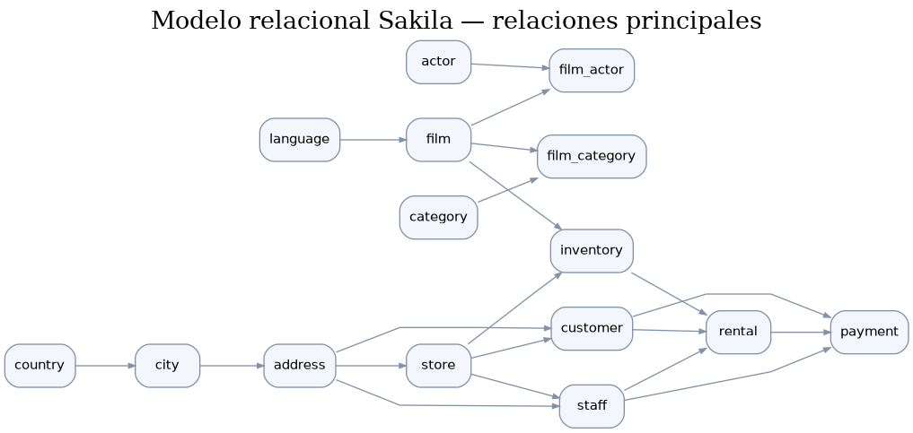

# DataProject · Lógica y consultas SQL — Sakila

Proyecto académico desarrollado para **PostgreSQL y DBeaver** a partir de la base de datos Sakila suministrada en el curso.

## Contenido del proyecto

Se resuelven los **64 puntos del enunciado**, desde la descripción del esquema hasta las consultas sobre películas, actores, categorías, alquileres, clientes y pagos. Las soluciones cubren filtros, ordenación, agregaciones, `GROUP BY`, `HAVING`, funciones estadísticas, `JOIN` (incluidos `LEFT`, `FULL` y `CROSS JOIN`), subconsultas, consultas con `EXISTS`, vistas y tablas temporales.

## Organización

```text
Proyecto_SQL_Sakila/
├── README.md
├── INSTRUCCIONES.md
├── base_de_datos/
│   └── BBDD_Proyecto_shakila_sinuser.sql
├── documentacion/
│   ├── ESQUEMA.md
│   └── esquema_relaciones.png
└── sql/
    ├── 00_todas_las_consultas.sql
    ├── 01_consultas_basicas.sql
    ├── 02_agrupaciones_y_subconsultas.sql
    ├── 03_relaciones_y_joins.sql
    ├── 04_vistas_y_temporales.sql
    ├── 05_consultas_avanzadas.sql
    └── 99_verificacion.sql
```

## Cómo utilizarlo

1. Crear una base de datos de trabajo vacía en PostgreSQL y abrirla en DBeaver.
2. Importar el archivo SQL original incluido en `base_de_datos/` (para versiones recientes de PostgreSQL, consultar los ajustes de compatibilidad descritos en `INSTRUCCIONES.md`).
3. Ejecutar `sql/99_verificacion.sql` para revisar la carga de tablas y datos.
4. Abrir `sql/00_todas_las_consultas.sql` y ejecutar los ejercicios numerados. También se pueden consultar agrupados por tema en los otros archivos SQL.
5. Para las consultas que crean tablas temporales, utilizar la misma sesión de conexión mientras se examinan los resultados.

## Esquema de relaciones



La explicación del modelo y el diagrama en formato Mermaid están en [`documentacion/ESQUEMA.md`](documentacion/ESQUEMA.md).

## Criterios de interpretación

- **Ejercicio 9:** la variabilidad del coste de reemplazo se describe mediante rango, varianza y desviación estándar.
- **Ejercicio 11:** se interpreta el antepenúltimo alquiler como el tercero desde el final por fecha de alquiler; el importe corresponde a los pagos registrados para ese alquiler.
- **Ejercicio 21:** la duración media de alquiler utiliza la diferencia entre fecha de alquiler y fecha de devolución, excluyendo registros aún abiertos.
- **Ejercicio 29:** se muestra el número de copias registradas en inventario, no necesariamente las copias libres en tiempo real.
- **Ejercicio 44:** el producto cartesiano combina cada película con todas las categorías, incluso con aquellas que no le corresponden; por eso **no aporta valor para identificar las categorías reales**. Es útil como ejemplo de `CROSS JOIN` y para generar combinaciones teóricas.
- **Ejercicio 58:** se identifican películas pertenecientes a la categoría `Animation`.
- **Ejercicios 51 y 52:** las tablas temporales pertenecen a la sesión de PostgreSQL en que se crean.

## Herramientas

- PostgreSQL: gestión y ejecución de las consultas.
- DBeaver: conexión, exploración del esquema, editor SQL y consulta de resultados.
- SQL: lenguaje utilizado para resolver los ejercicios.

## Fuente de datos

`BBDD_Proyecto_shakila_sinuser.sql`, conjunto de datos facilitado para la actividad. Se incluye sin alterar como material de partida.
