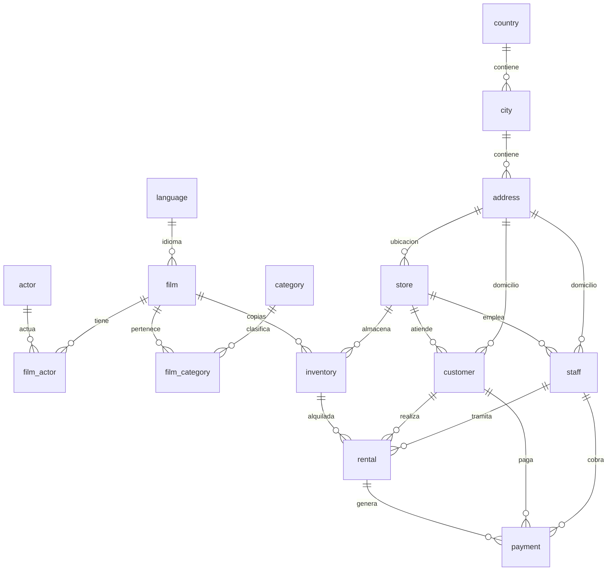

# Esquema de la base de datos Sakila

La base original crea 15 tablas principales. El diagrama siguiente resume sus principales relaciones (FK). Para una representación visual en DBeaver: seleccionar esquema `public` → **ER Diagram**.

**Nota:** el esquema original también contiene una relación de dirección `store.manager_staff_id → staff.staff_id`, circular respecto a `staff.store_id → store.store_id`, y `film.original_language_id → language.language_id`. La cardinalidad del dibujo es un resumen didáctico, no sustituye al diagrama generado desde PostgreSQL.

La estructura SQL original no se ha modificado y está en `base_de_datos/`. Incluye claves primarias y foráneas, índices, funciones y triggers propios de la versión facilitada.
